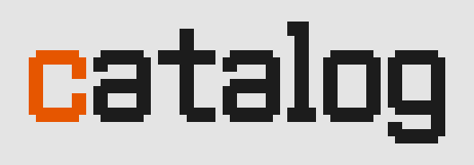

<p align="center">
  <a href="https://github.com/unaquatic/catalog">
    <picture>
      <source media="(prefers-color-scheme: dark)" srcset="docs/logo-dark.svg">
      
    </picture>
  </a>
</p>

<p align="center">
  <a href="https://go.dev/"></a>
  <a href="https://github.com/unaquatic/catalog/blob/main/LICENSE"></a>
</p>

<p align="center"><b>The model catalog of flow, built from models.dev, written in golang.</b></p>

---

## Install

Every merge to main is a release, tagged as the next semantic version: a Go module version whose `data` package embeds that version's catalog, and a GitHub release with the catalog as one `catalog.json`, its `schema.json`, models.dev's `catalog.json` it took changes from, and the patch of those changes.

```sh
go get github.com/unaquatic/catalog@latest
curl -LO https://github.com/unaquatic/catalog/releases/latest/download/catalog.json
```

```go
import "github.com/unaquatic/catalog/data"

c, err := data.Catalog() // *gateway.Catalog, embedded: no network
```

## Usage

```sh
go generate ./data/                               # apply models.dev's changes to our catalog, data/catalog
go run ./cmd/catalog serve -catalog data/catalog  # serve our catalog, and browse it at http://localhost:4100
go run ./cmd/catalog join -o catalog.json         # write our catalog as one catalog.json
go run ./cmd/catalog remap -in data/models-dev.json   # write remap.json: how the current mapping differs from our catalog
go run ./cmd/catalog apply -patch remap.json      # apply a reviewed patch to our catalog
go run ./cmd/catalog build -o catalog.json        # map models.dev alone, as a catalog of its own
go run ./cmd/catalog serve                        # serve that, mapped live from models.dev
go run ./cmd/catalog snapshot -providers anthropic,openai -o snapshot.json   # the catalog flow compiles in
```

## Hosted catalog

Our catalog, `data/catalog`, is its own source of truth, a file per lab's models and per provider: models.dev is where its data comes from, not what it is. Every six hours CI applies what models.dev changed since its last version to the catalog, as a patch, keeping what the catalog holds of its own, and opens a pull request of it to review and squash-merge; its merge is released as the next version, as every merge is, and deploys the browser and `catalog.json` to:

- https://aquatic.dev/catalog/ — what flow reads (`gateway.DefaultSource`)
- https://unaquatic.github.io/catalog/ — a mirror

`catalog.json` names its JSON Schema (draft 2020-12) in `"$schema"`: https://aquatic.dev/catalog/schema.json, generated from the Go types into `gateway/catalog.schema.json`.

## Packages

The public API, which every release versions:

- `gateway` — the catalog format, decoding it and resolving a call, its JSON Schema, and the `Store` that clients such as flow read it with.
- `gateway/gatewaytest` — catalogs for tests, built from models.dev api.json documents, and `Store` caches of them.
- `data` — our catalog (`catalog/`: `catalog.json`, `models/<lab>.json`, `providers/<id>.json`), models.dev's catalog.json it last took changes from (`models-dev.json`), and the patch of those changes (`patch.json`).

Internal to the module:

- `cmd/catalog` — applies models.dev's changes to the catalog (`update`), remaps and patches it (`remap`, `apply`), joins it into one document (`join`), builds a catalog from models.dev alone, serves a catalog as the site does (the page, `catalog.json` and `schema.json`), and writes snapshots.
- `internal/build` — the mapping from models.dev to the catalog, and its rules (`internal/build/rules.json`).
- `internal/catalogdir` — the file layout of `data/catalog`.
- `internal/modelsdev` — models.dev's catalog.json, and the cache and fetcher of downloads.

## License

Catalog is released under the [MIT License](LICENSE).
